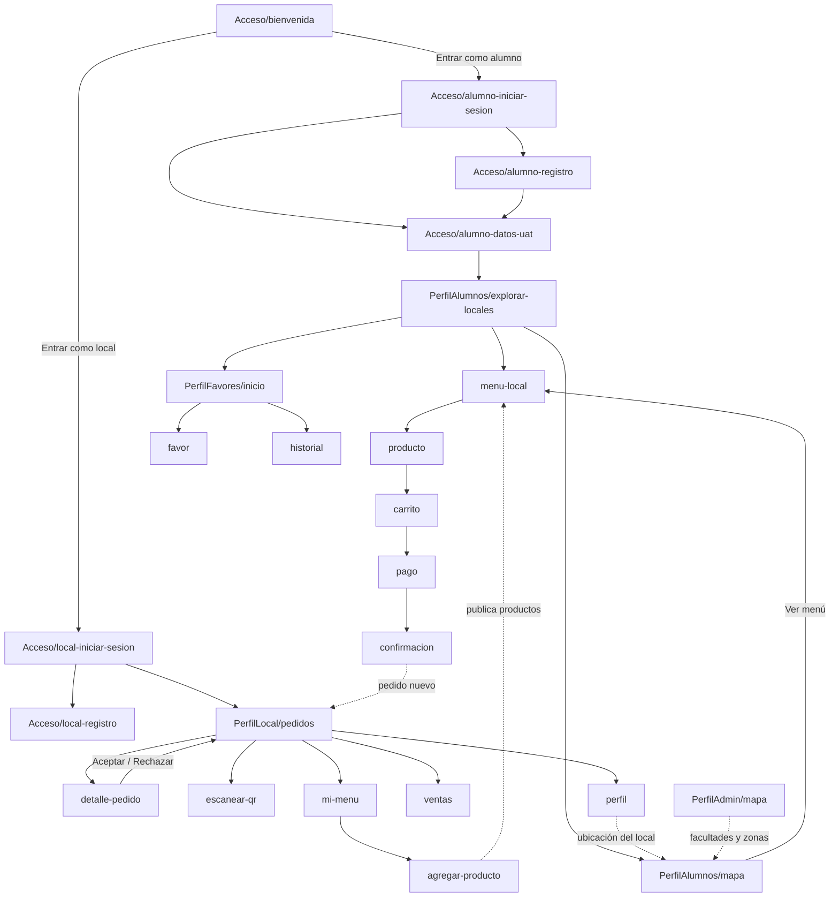

# Diagrama de Pick Up UAT

Cada pantalla del diseño en Figma (archivo `3ku3u2aHkv109klsyMFXXv`, página "Pick Up UAT") tiene su archivo en el repositorio.

| Figma | Archivo |
|---|---|
| Acceso/Bienvenida | `Acceso/bienvenida.html` |
| Acceso/Alumno · iniciar sesión (temporal) | `Acceso/alumno-iniciar-sesion.html` |
| Acceso/Alumno · registro (temporal) | `Acceso/alumno-registro.html` |
| Acceso/Alumno · datos de la UAT | `Acceso/alumno-datos-uat.html` |
| Acceso/Local · iniciar sesión | `Acceso/local-iniciar-sesion.html` |
| Acceso/Registro local | `Acceso/local-registro.html` |
| Alumno/Explorar locales | `PerfilAlumnos/explorar-locales.html` |
| Alumno/Menú del local | `PerfilAlumnos/menu-local.html` |
| Alumno/Producto e instrucciones | `PerfilAlumnos/producto.html` |
| Alumno/Carrito y horario | `PerfilAlumnos/carrito.html` |
| Alumno/Pago | `PerfilAlumnos/pago.html` |
| Alumno/Confirmación | `PerfilAlumnos/confirmacion.html` |
| (sin pantalla en Figma) Mapa de la UAT | `PerfilAlumnos/mapa.html` (facultades, zonas y dónde comer) |
| (sin pantalla en Figma) Favores · inicio | `PerfilFavores/inicio.html` (ganancias, favores hechos y favores libres) |
| (sin pantalla en Figma) Favores · mi favor | `PerfilFavores/favor.html` (ir al local, llevarlo al punto, código) |
| (sin pantalla en Figma) Favores · historial | `PerfilFavores/historial.html` |
| Local móvil/Pedidos | `PerfilLocal/pedidos.html` |
| Local móvil/Detalle del pedido | `PerfilLocal/detalle-pedido.html` |
| Local móvil/Escanear QR | `PerfilLocal/escanear-qr.html` |
| Local móvil/Mi menú | `PerfilLocal/mi-menu.html` |
| Local móvil/Agregar producto | `PerfilLocal/agregar-producto.html` (también edita y elimina) |
| Barra del local · Ventas | `PerfilLocal/ventas.html` |
| Barra del local · Perfil | `PerfilLocal/perfil.html` (datos, logo, horario, su lugar en el mapa, cerrar sesión) |
| (sin pantalla en Figma) Lugares del mapa | `PerfilAdmin/mapa.html` (solo administradores: colocar, mover, renombrar y quitar facultades y zonas) |

La versión de escritorio del local (secundaria) usa las mismas páginas de `PerfilLocal/`: desde 900 px de ancho la barra inferior pasa a barra lateral y los pedidos se ven en tres columnas (Nuevos, En preparación, Listos).

El mapa (Leaflet con los mapas de OpenStreetMap) vive en `Compartido/js/mapa.js` y `Compartido/css/mapa.css`, con la misma paleta: facultades en azul, zonas en gris y dónde comer en oro. Lo usan el mapa de los alumnos, la ruta A → B del favor en el carrito y en `PerfilFavores/favor.html`, el perfil del local y el editor de lugares.

Colores, tipografía (Inter) e iconos del Figma están en `Compartido/css/estilos.css` y `Compartido/js/iconos.js`.

El QR del pedido lleva el texto `PICKUP-<número>`; el local lo lee con la cámara en `escanear-qr.html` (o escribe el número).
