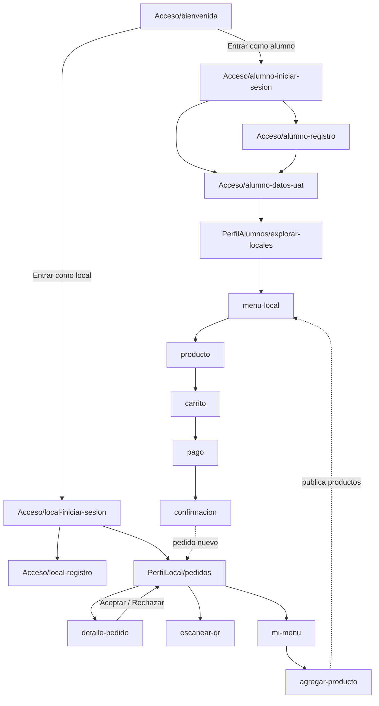

# Diagrama de Pick Up UAT

Cada pantalla del diseño en Figma (archivo `3ku3u2aHkv109klsyMFXXv`, página "Pick Up UAT") tiene su archivo en el repositorio.

| Figma | Archivo |
|---|---|
| Acceso/Bienvenida | `Acceso/bienvenida.html` |
| Acceso/Alumno · iniciar sesión (temporal) | `Acceso/alumno-iniciar-sesion.html` |
| Acceso/Alumno · registro (temporal) | `Acceso/alumno-registro.html` |
| Acceso/Alumno · datos de la UAT | `Acceso/alumno-datos-uat.html` |
| Acceso/Local · iniciar sesión | `Acceso/local-iniciar-sesion.html` |
| Acceso/Registro local | `Acceso/local-registro.html` |
| Alumno/Explorar locales | `PerfilAlumnos/explorar-locales.html` |
| Alumno/Menú del local | `PerfilAlumnos/menu-local.html` |
| Alumno/Producto e instrucciones | `PerfilAlumnos/producto.html` |
| Alumno/Carrito y horario | `PerfilAlumnos/carrito.html` |
| Alumno/Pago | `PerfilAlumnos/pago.html` |
| Alumno/Confirmación | `PerfilAlumnos/confirmacion.html` |
| Local móvil/Pedidos | `PerfilLocal/pedidos.html` |
| Local móvil/Detalle del pedido | `PerfilLocal/detalle-pedido.html` |
| Local móvil/Escanear QR | `PerfilLocal/escanear-qr.html` |
| Local móvil/Mi menú | `PerfilLocal/mi-menu.html` |
| Local móvil/Agregar producto | `PerfilLocal/agregar-producto.html` |

La versión de escritorio del local (secundaria) usa las mismas páginas de `PerfilLocal/`, adaptadas con CSS para pantallas grandes.
